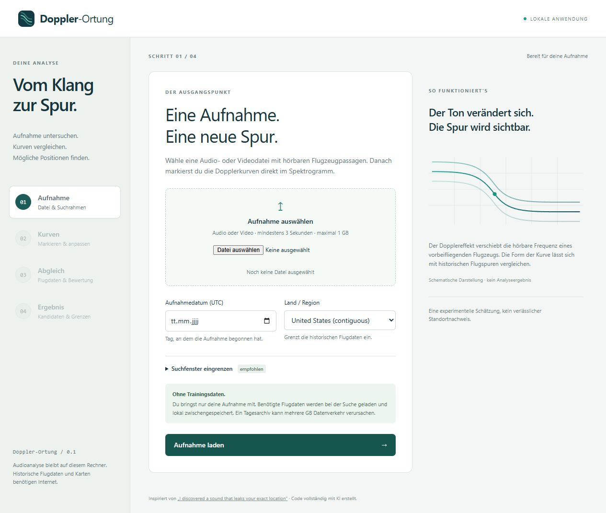

# Doppler-Ortung

Schätzt den Aufnahmeort von Flugzeuggeräuschen. Markierte Dopplerkurven werden mit historischen Flugdaten verglichen und mögliche Standorte auf einer Karte angezeigt. Die Aufnahme wird lokal verarbeitet. Code mit KI erstellt.

**[Windows-Paket herunterladen](https://github.com/LeNevio1337/Doppler-Ortung/releases/latest/download/Doppler-Ortung-Windows.zip)**

## Installation für Windows

Paket vollständig entpacken. Keine zusätzliche Installation nötig; Internet für Flugdaten und Karten erforderlich.

## Start

`Start.cmd` doppelklicken. Die Oberfläche öffnet sich im Browser. Das Startfenster offen lassen.

## Bedienung

Aufnahme, UTC-Datum und Suchregion wählen, eine Kurve markieren und den Abgleich starten. Mit `Strg+C` im Startfenster beenden.
